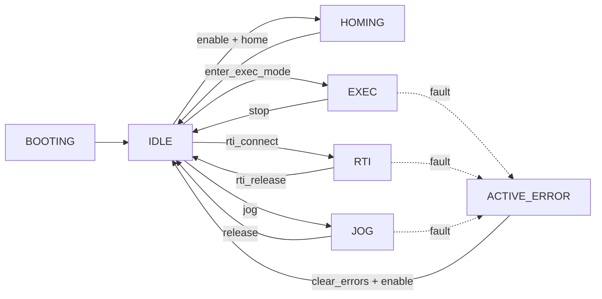
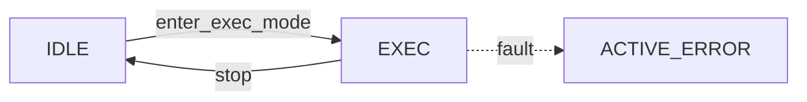
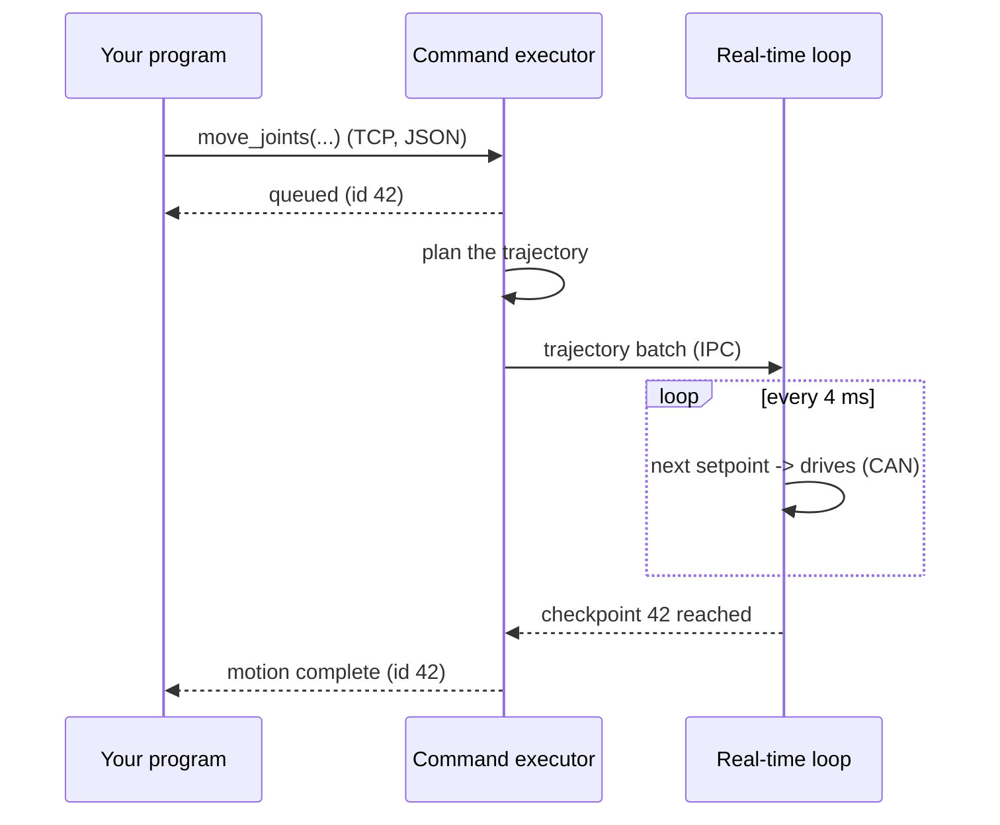
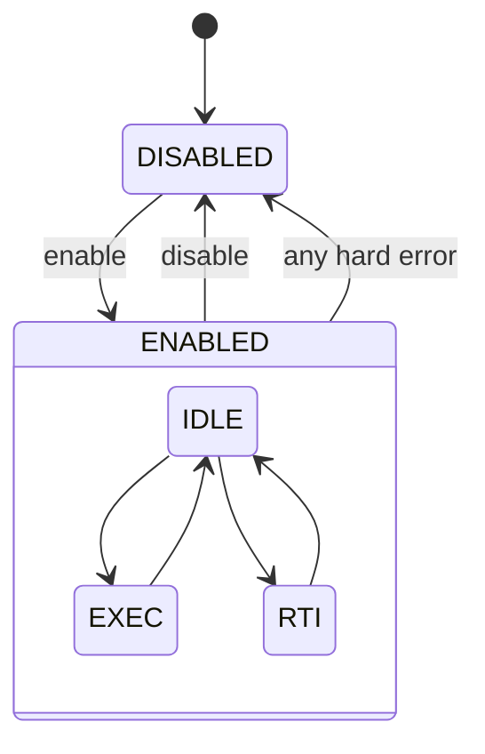
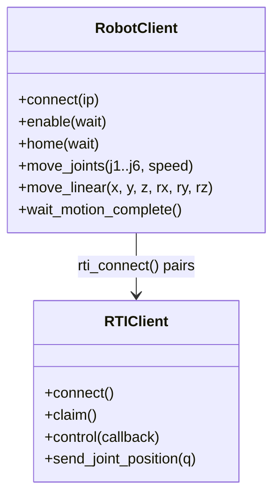
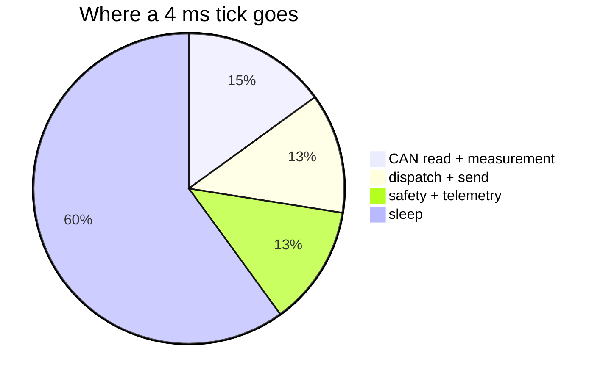
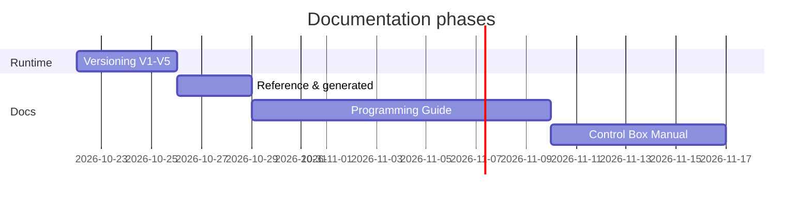

# Diagrams and math

Diagrams are text (Mermaid) rendered in the browser, so they follow the colour scheme and can be edited like any
paragraph. Math is LaTeX rendered by MathJax.

## Flowchart



````markdown

````

## Sequence diagram



## State diagram



## Class diagram



## Pie and Gantt





## Math

Inline: the joint torque is $\tau = K_t \, i_q \, N \, \eta$, and the TCP force follows from $\tau = J^T F$.

Block:

$$
{}^{i-1}T_i =
\begin{bmatrix}
\cos\theta_i & -\sin\theta_i\cos\alpha_i & \sin\theta_i\sin\alpha_i & a_i\cos\theta_i \\
\sin\theta_i & \cos\theta_i\cos\alpha_i & -\cos\theta_i\sin\alpha_i & a_i\sin\theta_i \\
0 & \sin\alpha_i & \cos\alpha_i & d_i \\
0 & 0 & 0 & 1
\end{bmatrix}
$$

```markdown
Inline: the joint torque is $\tau = K_t \, i_q \, N \, \eta$.

$$
{}^{i-1}T_i = \begin{bmatrix} \cos\theta_i & \dots \end{bmatrix}
$$
```
