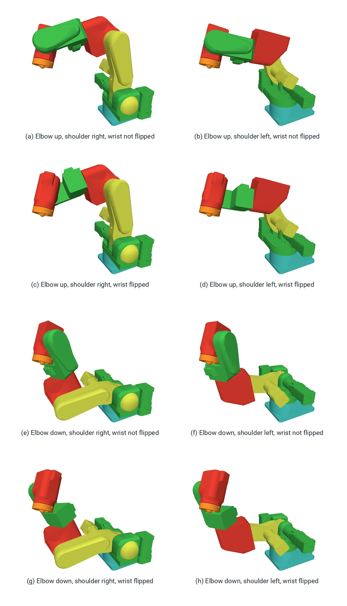

# Configurations, singularities and workspace

*Stub.* <!-- sources: planning/01_structure_proposal_v1.md §4 -->

## Configurations

A six-axis arm with a spherical wrist can reach most tool poses in eight ways, its **configurations**: three
choices with two answers each.

- **Shoulder right or left**: the wrist centre in front of the joint 1 axis, or behind it with joint 1 turned
  about 180° and the arm reaching back over itself.
- **Elbow up or down**: the elbow above or below the line from the shoulder to the wrist centre.
- **Wrist flipped or not**: joint 5 positive or negative; joints 4 and 6 turn by 180° to keep the tool where it
  is.

The figure shows all eight for one tool pose: PAR6 with nothing on the flange, the tool centre point 250 mm in
front of the base and 230 mm up, the tool tilted 30° from vertical. The flange is in exactly the same place and
orientation in every picture; only the joints differ. The colours mark the links: base turquoise, joint 1 green,
upper arm yellow, elbow red, forearm green, wrist red, flange orange.

{ width="700" }

The figure is the mathematics: all eight reach the pose. The joint limits are not marked, because the PAR6 model in
[robot_descriptions](https://github.com/Source-Robotics/robot_descriptions), from which the poses were solved and
drawn, carries none; the runtime's joint limits decide which of these the arm can actually take, and several would
also make the arm hit itself.
