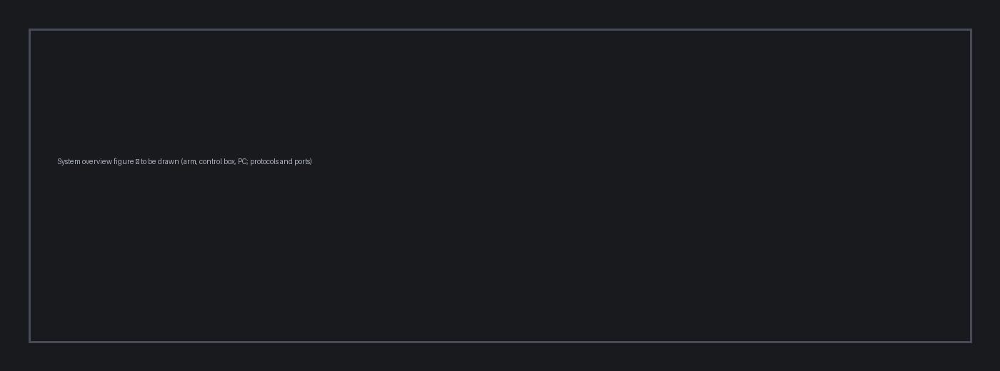

---
hide:
  - toc
---

# Simulation and AI Guide

{ .hero }

<!-- doc-meta: simulation -->

Source Robotics d.o.o. publishes this document as part of the open-source PAR6 project. It is revised as the product changes; the document number, revision and date above identify the version you are reading, and the revision history on the next page says what changed. Take care that the revision you follow matches the hardware revision or runtime version named under *Applies to*. The licence that covers this text is stated in the documentation repository.
